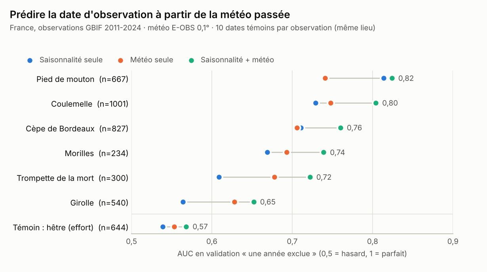
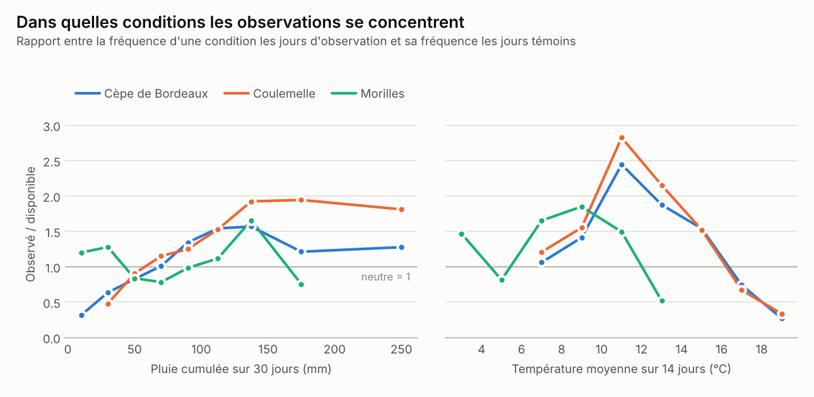
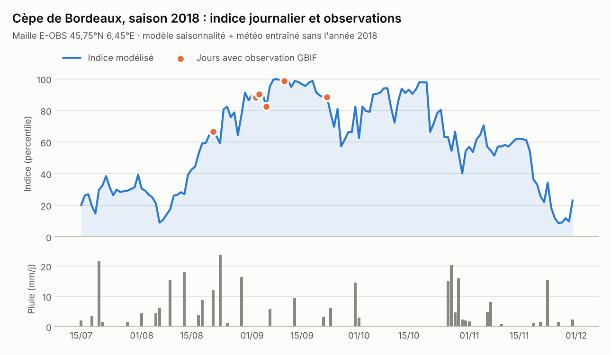

# 5. Étude de faisabilité sur données réelles

[← Retour au sommaire](README.md)

**Question :** avec des données ouvertes (observations GBIF + météo gridée), peut-on prédire *quand* une espèce fructifie mieux que la simple saisonnalité ? Si oui, le cœur dynamique de Mushroomator est faisable.

**Réponse courte : oui pour 5 espèces sur 6**, avec des gains nets pour le cèpe, la coulemelle, la trompette de la mort, la girolle et les morilles ; un témoin (le hêtre) montre que le signal n'est pas un artefact du comportement des observateurs.

## 5.1 Protocole

Méthode de la « niche phénologique » ([Capinha et al. 2024](https://doi.org/10.1093/biosci/biae041)), adaptée à la France :

| Élément | Choix |
|---|---|
| Observations | GBIF, France, 2011–2024, observations humaines, présences seules ; exclusion du jeu synthétique ABDSM, des dates au 1er du mois et des intervalles de dates ; incertitude ≤ 5 km quand elle est renseignée ; **une observation par maille de 0,1° et par jour** |
| Espèces | cèpe de Bordeaux, girolle, trompette de la mort, pied de mouton, coulemelle, morilles (genre) |
| Météo | **E-OBS v30.0e** (pluie et température moyenne quotidiennes, 0,1° ≈ 11 km, 2011 → 06/2024), extraite sur la France |
| Fenêtre de saison | 2,5ᵉ–97,5ᵉ percentiles des dates d'observation de chaque espèce (ex. cèpe : 15/06–03/12) |
| Pseudo-absences | **10 dates témoins par observation, au même endroit**, tirées dans la fenêtre de saison ; années tirées selon la distribution des années d'observation (variante « même année » en contrôle de robustesse) |
| Variables | 4 de saison et de position (jour de l'année en sinus/cosinus, latitude, longitude) et 22 météo : pluies cumulées sur 1 à 60 jours, pluies décalées (J-14→J-7, J-21→J-14, J-28→J-21, J-42→J-28), températures moyennes sur 3 à 30 jours, variation de température sur une semaine, bilan hydrique « seau » (pluie − évapotranspiration de Hamon, réserve 120 mm), jours depuis la dernière pluie ≥ 10 mm, jours de pluie sur 14 jours |
| Modèles | arbres boostés (`HistGradientBoostingClassifier`) : **saisonnalité seule** (jour de l'année + position), **météo seule**, **saisonnalité + météo** |
| Validation | **une année exclue** à tour de rôle (temporel) et **blocs spatiaux de 2°** (≈ 200 km) |
| Témoin d'effort | **hêtre** (*Fagus sylvatica*, iNaturalist, mêmes filtres, fenêtre du cèpe) : un arbre est observable quelle que soit la météo des semaines passées ; tout « signal météo » à son sujet mesure le comportement des observateurs |

Lecture de l'AUC : probabilité qu'une date d'observation tirée au hasard reçoive un score plus élevé qu'une date témoin tirée au hasard (0,5 = hasard, 1 = parfait). Le **lift** est l'enrichissement des 10 % de couples (lieu, jour) les mieux notés : un lift de 2,6 signifie qu'ils contiennent 26 % des observations au lieu de 10 %.

## 5.2 Résultats

<picture>
  <source media="(prefers-color-scheme: dark)" srcset="figures/auc_dark.png">
  
</picture>

Tableau complet (variante principale, années tirées selon la distribution des observations) :

| Espèce | Obs. | Mailles | Fenêtre | AUC saison | AUC météo | AUC saison + météo | Gain | AUC blocs spatiaux (s + m) | Lift top 10 % |
|---|---:|---:|---|---:|---:|---:|---:|---:|---:|
| Pied de mouton | 667 | 326 | 17/01–17/12 | 0,81 | 0,74 | **0,82** | +0,01 | 0,82 | 3,0 |
| Coulemelle | 1 001 | 672 | 25/05–26/11 | 0,73 | 0,75 | **0,80** | +0,08 | 0,83 | 3,0 |
| Cèpe de Bordeaux | 827 | 456 | 15/06–03/12 | 0,71 | 0,71 | **0,76** | +0,05 | 0,78 | 2,6 |
| Morilles | 234 | 177 | 15/03–25/06 | 0,67 | 0,69 | **0,74** | +0,07 | 0,76 | 2,3 |
| Trompette de la mort | 300 | 194 | 17/06–12/12 | 0,61 | 0,68 | **0,72** | +0,11 | 0,74 | 2,0 |
| Girolle | 540 | 296 | 13/05–23/11 | 0,56 | 0,63 | **0,65** | +0,09 | 0,68 | 1,6 |
| *Témoin : hêtre* | 644 | 427 | 15/06–03/12 | 0,54 | 0,55 | **0,57** | +0,03 | 0,58 | 1,2 |

Variante « même année » (les dates témoins sont prises dans l'année de l'observation, ce qui neutralise les différences d'effort entre années mais supprime le contraste entre années sèches et humides) : cèpe 0,74 → 0,77 ; coulemelle 0,76 → 0,81 ; trompette 0,67 → 0,72 ; morilles 0,73 → 0,75 ; girolle 0,62 → 0,65 ; pied de mouton 0,84 → 0,83 ; hêtre 0,58 → 0,56. Les conclusions sont les mêmes.

### Les conditions des jours d'observation

Médianes, jours d'observation / jours témoins :

| Espèce | Pluie sur 30 j (mm) | Pluie J-20 → J-14 (mm) | Temp. moyenne 14 j (°C) | Bilan hydrique (0–1) | Jours depuis une pluie ≥ 10 mm |
|---|---|---|---|---|---|
| Cèpe de Bordeaux | **84** / 65 | **17,6** / 11,7 | **13,1** / 15,4 | **0,82** / 0,70 | 8 / 10 |
| Coulemelle | **84** / 60 | **20,0** / 10,2 | **13,1** / 16,6 | **0,82** / 0,62 | 9 / 11 |
| Trompette de la mort | **77** / 68 | **14,2** / 11,8 | **13,0** / 15,8 | **0,85** / 0,72 | 8 / 10 |
| Girolle | **85** / 72 | **15,7** / 13,2 | 15,6 / 15,2 | **0,83** / 0,76 | 6 / 8 |
| Pied de mouton | 75 / 69 | 13,1 / 11,7 | 12,2 / 11,2 | 0,85 / 0,86 | 8 / 10 |
| Morilles | 68 / 70 | 13,8 / 13,5 | **9,1** / 10,8 | 0,89 / 0,88 | 12 / 10 |
| *Témoin : hêtre* | *60 / 66* | *9,9 / 10,7* | *17,1 / 16,3* | *0,62 / 0,68* | *11 / 10* |

<picture>
  <source media="(prefers-color-scheme: dark)" srcset="figures/conditions_dark.png">
  
</picture>

Lecture : au-dessus de 1, la condition est plus fréquente les jours d'observation que les jours témoins. Pour le cèpe, le rapport passe de **0,3** sous 20 mm de pluie en 30 jours à **~1,5** entre 100 et 150 mm (×5). La température moyenne sur 14 jours la plus favorable se situe entre **10 et 12 °C** pour le cèpe et la coulemelle (rapport 2,4 à 2,8) et entre **8 et 10 °C** pour les morilles, avec une chute nette au-delà de 16 °C. Attention : ces courbes univariées incluent l'effet de la saison (il fait plus frais en octobre, pic de la saison) ; c'est la comparaison des modèles ci-dessus qui isole l'apport propre de la météo.

### Quelles variables comptent ?

Baisse d'AUC quand on permute un groupe de variables sur l'année exclue (importance par permutation, moyenne sur les années) :

| Espèce | Saison | Température | Pluie 2–8 semaines | Pluie récente (1–7 j) | Bilan hydrique |
|---|---:|---:|---:|---:|---:|
| Cèpe de Bordeaux | 0,12 | **0,09** | 0,04 | 0,01 | 0,00 |
| Coulemelle | 0,18 | **0,09** | 0,05 | 0,00 | 0,01 |
| Morilles | 0,13 | **0,14** | 0,01 | 0,02 | -0,01 |
| Girolle | 0,03 | **0,06** | 0,02 | 0,00 | 0,05 |

La **température** est le premier facteur météo, suivie de la **pluie cumulée sur 2 à 8 semaines** ; la pluie des tout derniers jours compte peu, ce qui confirme les délais de 1 à 3 semaines rapportés dans la littérature ([chapitre 1](01-ecologie-fructification.md#délais-pluie--récolte)). Le bilan hydrique « seau » est redondant avec les cumuls de pluie, sauf pour la girolle (longue saison estivale, où la sécheresse est limitante). Ces résultats sont cohérents avec [Krah et al. 2023](https://doi.org/10.1111/ele.14275) et [Andrew et al. 2018](https://doi.org/10.1002/ecy.2237) (la température cadence la phénologie) et avec l'optimum d'environ 13 °C rapporté pour le cèpe ([Brejon Lamartinière & Hoffman 2025](https://www.biorxiv.org/content/10.64898/2025.12.12.693895v1.full)).

### Exemple : une saison vue par le modèle

<picture>
  <source media="(prefers-color-scheme: dark)" srcset="figures/saison_cepe_dark.png">
  
</picture>

Maille de 0,1° en Savoie (45,75° N, 6,45° E) contenant le plus de jours d'observation de cèpe sur une même saison (6 jours en 2018). Le modèle a été entraîné **sans 2018** ; l'indice est exprimé en percentile des dates témoins de 2018. Les six observations tombent sur des jours notés entre le 67ᵉ et le 99ᵉ percentile (cinq sur six au-dessus du 80ᵉ), après la remontée de l'indice qui suit les pluies de la mi-août. On voit aussi une limite : l'indice reste haut en octobre malgré l'absence de pluie, le modèle s'appuyant alors sur la saison et la température ; une meilleure humidité du sol (SIM2) devrait corriger ce comportement.

## 5.3 Ce que l'étude montre… et ne montre pas

**Montré :**
- Les données ouvertes suffisent pour apprendre un signal météo exploitable, **transférable d'une année à l'autre et d'une région à l'autre** (les AUC en blocs spatiaux sont du même ordre que les AUC temporelles).
- Le signal est **biologique**, pas seulement comportemental : le témoin hêtre reste proche du hasard (0,57), et les jours où l'on observe des hêtres sont même *plus secs* que la moyenne, à l'inverse des champignons.
- Les espèces diffèrent : la girolle (sporophores persistants, longue saison) est la plus difficile ; le pied de mouton est dominé par la saison ; les morilles répondent surtout à la température.

**Non montré (limites) :**
- Il s'agit d'un indice **relatif** : sans absences, pas de probabilité absolue (§ 3.1 du [chapitre 3](03-methodes-de-modelisation.md)).
- Pas de couche habitat : l'étude ne dit pas *où* chercher, seulement *quand* aux endroits déjà connus.
- Météo à ~11 km, pas d'altitude, humidité du sol approchée par un modèle de seau grossier ; E-OBS s'arrête en juin 2024.
- Échantillons modestes (234 à 1 001 observations par espèce) ; AUC plus basses que les 0,90 de [Capinha 2019](https://doi.org/10.1007/s00484-019-01714-0) car nos dates témoins sont restreintes à la saison (tâche plus difficile, par construction).
- **E-OBS est sous licence non commerciale** : ce choix convient à la recherche, pas au produit (remplacer par SIM2/ERA5-Land).

## 5.4 Améliorations attendues (par ordre de rendement estimé)

1. Humidité du sol SIM2 et pluie COMEPHORE 1 km à la place d'E-OBS + correction d'altitude des températures.
2. Pré-entraînement sur l'Europe entière (10 à 30 fois plus d'observations par espèce), puis ajustement sur la France.
3. Couche habitat (SDM) pour passer de « quand » à « où et quand ».
4. Pondération par l'effort (groupe cible) et filtrage plus fin des jeux de données.
5. Calibration par des retours « trouvé / rien » pour obtenir de vraies probabilités.

## 5.5 Reproduire

Les scripts sont dans [`research/feasibility/`](../../research/feasibility/README.md) (environ 15 minutes de calcul et 1,2 Go de téléchargement).

[Chapitre suivant : architecture et feuille de route →](06-architecture-et-feuille-de-route.md)
