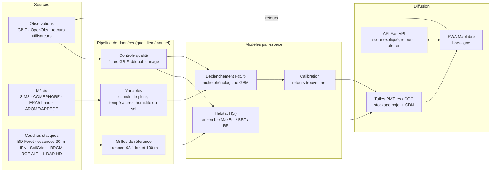

# 6. Architecture proposée et feuille de route

[← Retour au sommaire](README.md)

## 6.1 Principe : deux couches, deux rythmes

L'idée clé de l'architecture découle de l'écologie ([chapitre 1](01-ecologie-fructification.md)) : **l'habitat change lentement et à fine échelle, la météo change vite et à grande échelle.**

| Couche | Résolution | Rafraîchissement | Volume |
|---|---|---|---|
| **Habitat** `H(x)` par espèce (hôtes, sol, relief, climat moyen) | 25–100 m | 1 fois par an | lourd à calculer, mais une seule fois |
| **Déclenchement** `F(x, t)` par espèce (météo passée + prévue) | 1 km (température corrigée de l'altitude) | chaque jour, J-30 → J+7 | léger : ~550 000 mailles de 1 km sur la France |
| **Indice affiché** `H(x) × F(x, t)` | 25–100 m | à l'affichage | combiné côté client ou au rendu des tuiles |

On pré-calcule une fois par an les tuiles d'habitat, et chaque jour une petite grille dynamique ; le produit se fait au rendu. Le calcul quotidien reste minime, et l'application peut afficher séparément « bon habitat » et « bonnes conditions », ce qui rend le score explicable.

## 6.2 Vue d'ensemble

## 6.3 Choix techniques recommandés

| Besoin | Recommandation | Pourquoi |
|---|---|---|
| Traitements | **Python** : `xarray`, `rioxarray`, `geopandas`, **LightGBM**, `scikit-learn` | standard de la géo-data science, cohérent avec l'étude de faisabilité |
| Orchestration | tâches planifiées simples au début (cron ou GitHub Actions), puis Prefect ou Dagster | un seul pipeline quotidien au départ |
| Stockage | stockage objet (S3 compatible) pour les grilles (**COG**, **Zarr**) et les tuiles (**PMTiles**) ; **PostgreSQL + PostGIS** pour utilisateurs, retours, zones favorites | les PMTiles se servent comme un simple fichier via CDN, sans serveur de tuiles |
| API | **FastAPI** : score expliqué en un point, enregistrement des retours, alertes | léger, typé, documentation automatique |
| Carte | **MapLibre GL JS** (open source), PWA | rendu WebGL fluide, tuiles vecteur et raster, aucune licence propriétaire |
| Hors-ligne | service worker + téléchargement des tuiles d'une zone avant la sortie | **en forêt, le réseau mobile est souvent absent** |
| Mobile | PWA d'abord, puis Capacitor pour les stores (ou React Native/Flutter + MapLibre natif) | un seul code au démarrage |
| Suivi des modèles | MLflow (versions, métriques, données d'entraînement) | traçabilité de la validation publiée |
| Grille d'affichage des retours | hexagones **H3** (résolution 7–8, soit environ 5 km² et 0,7 km²) | agrégation anonymisante des retours utilisateurs |

**Ordres de grandeur.** La forêt couvre environ 17 millions d'hectares en métropole : ~2,7 M de mailles à 250 m, ~17 M à 100 m. Prédire 12 espèces sur 8 jours directement à 250 m représente quelques centaines de millions d'évaluations de GBM par jour, contre seulement ~50 M avec le découpage habitat/déclenchement (550 000 mailles × 12 espèces × 8 jours) : quelques minutes sur un serveur de 4 à 8 cœurs. Les coûts d'hébergement d'un prototype sont donc de l'ordre de quelques dizaines d'euros par mois, hors abonnement éventuel à une API météo commerciale.

## 6.4 Risques, éthique et réglementation

| Risque | Gravité | Mesures |
|---|---|---|
| **Intoxications** (1 363 cas symptomatiques et 3 décès sur le 2ᵉ semestre 2024, [ANSES](https://www.anses.fr/fr/content/cueillette-des-champignons-vigilance-face-aux-risques-dintoxications)) | critique | jamais d'identification ni de mention « comestible » sans avertissement ; fiche « confusions dangereuses » par espèce (clitocybe de l'olivier pour la girolle, gyromitres pour les morilles…) ; rappel : faire contrôler sa cueillette par un pharmacien ou un mycologue ; numéro des centres antipoison |
| **Propriété privée** : les champignons appartiennent au propriétaire du terrain | élevée | couche forêts publiques / privées (BD TOPO `foret_publique`) ; rappel des règles |
| **Quotas** : dans les forêts relevant du régime forestier (forêts publiques gérées par l'ONF), l'autorisation est présumée jusqu'à 5 L sauf réglementation contraire ; sans autorisation du propriétaire, un prélèvement de moins de 10 L est une contravention de 4ᵉ classe (code forestier, art. R163-5) et au-delà de 10 L un délit (art. L163-11) ; les arrêtés préfectoraux fixent souvent des limites par personne et par jour | moyenne | rappel contextuel ; lien vers les arrêtés ; *à revérifier sur Légifrance avant publication* (source : [réponse ministérielle n° 89175, 2015](https://questions.assemblee-nationale.fr/dyn/14/questions/QANR5L14QE89175.pdf)) |
| **Espaces protégés** (cœurs de parcs nationaux, réserves) | moyenne | masque des zones où la cueillette est interdite |
| **Surexploitation, piétinement** des zones signalées | moyenne | ne jamais afficher les retours individuels ; agréger (H3) et flouter ; pas de « coins » partagés |
| **Données personnelles** (RGPD) : la géolocalisation est une donnée personnelle | élevée | minimisation, consentement explicite, coins stockés chiffrés sur l'appareil (approche de Boletik), retours anonymisés et agrégés |
| **Licences de données** | élevée si commercial | E-OBS et Open-Meteo gratuit : non commerciaux ; GBIF : exclure les observations CC-BY-NC (~11 % des champignons en France) ou rester non commercial ; IGN, Météo-France, Copernicus : commercial autorisé avec attribution |
| **Fausse précision** (indice élevé, rien trouvé) | moyenne | afficher l'incertitude, expliquer le score, calibrer avec les retours |
| **Dérive climatique** des modèles | moyenne | réentraînement annuel, surveillance de l'extrapolation |
| **Démarrage à froid** des retours | moyenne | bêta avec des sociétés mycologiques ; gamification légère |
| **Concurrence** (≥ 7 services) | élevée | différenciation par la rigueur, la calibration et la transparence ([chapitre 4](04-existant-et-concurrence.md)) |

## 6.5 Feuille de route

### Phase 0 — Fondations (2 à 4 semaines)

- Ingestion : GBIF avec les filtres du [chapitre 2](02-sources-de-donnees.md#pièges-constatés-dans-les-données-gbif-françaises), météo (ERA5-Land via Open-Meteo pour commencer, puis SIM2), BD Forêt V2, SoilGrids, MNT.
- Grilles de référence (Lambert-93, 1 km et 100 m) et calcul des variables.
- **Modèle 0 à règles expertes** pour 3 espèces (cèpe, girolle, morilles).
- **Banc de validation** : rejeu des saisons 2016–2025, métriques du [§ 3.8](03-methodes-de-modelisation.md#38-validation).
- *Critère de passage* : pipeline quotidien automatisé ; modèle 0 évalué.

### Phase 1 — Prototype de carte (1 à 2 mois)

- Modèle de déclenchement (niche phénologique) pré-entraîné sur l'Europe puis ajusté sur la France, 6 à 10 espèces.
- Modèle d'habitat (ensemble réglé, fond « groupe cible »).
- PWA MapLibre : choix de l'espèce, curseur de date (J-30 → J+7), couches habitat / conditions / indice, « pourquoi ce score », fiches sécurité.
- *Critère de passage* : sur deux saisons rejouées, AUC temporelle ≥ modèle 0 + 0,05, enrichissement du top 10 % ≥ 2, indice de Boyce > 0,5.

### Phase 2 — Bêta terrain (une saison : printemps pour les morilles, ou automne)

- Retours « trouvé / rien trouvé » avec effort (durée, zone), mode hors-ligne, alertes sur zones favorites.
- Calibration de l'indice en probabilités par région ; tableau de bord de validation public.
- Partenariats : sociétés mycologiques (FongiFrance, SMF), CTFC, ONF.

### Phase 3 — Maturité

- Modèle intégré présence seule + inventaires + retours avec détection imparfaite.
- Pluie radar 1 km (COMEPHORE), structure forestière (LiDAR HD), plus d'espèces, extension européenne.
- Modèles de séquences multi-espèces ; publication scientifique de la méthode et de la validation.

## 6.6 Prochaines décisions à prendre

1. **Modèle économique** : gratuit/non commercial (accès à toutes les données, y compris CC-BY-NC et Open-Meteo gratuit) ou payant (sources commerciales uniquement) ?
2. **Périmètre initial** : toute la France pour 3 espèces, ou une région test pour 8–10 espèces ?
3. **Plateforme** : PWA seule au départ (recommandé) ou application native ?
4. **Partenariats scientifiques** : contacter le CTFC (données de placettes) et les sociétés mycologiques dès la phase 1 ?

[Bibliographie →](references.md)
