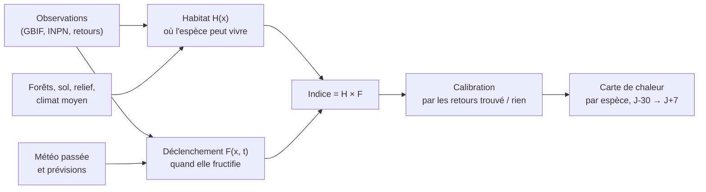

# Dossier de recherche — Mushroomator

*Rédigé le 24 octobre 2026. Objectif : déterminer comment construire une carte de chaleur de la probabilité de trouver des champignons comestibles, espèce par espèce, à partir de la météo passée et prévue, de l'humidité, des arbres, du sol et du relief.*

> **Objectif du projet : un outil qui aide à identifier les coins à champignons** (où chercher à l'échelle du coin, et quand y aller). Un premier prototype pour Rhône-Alpes est en service ([chapitre 7](07-prototype-rhone-alpes.md)) : fiable pour le *quand*, pas encore pour le *où*. Les pistes pour situer les coins sont au [chapitre 8](08-identifier-les-coins.md).

## L'essentiel en une page

1. **Ce qui fait pousser un champignon est bien connu dans les grandes lignes.** Il faut que le mycélium soit là (*habitat* : arbre-hôte pour les espèces mycorhiziennes comme le cèpe ou la girolle, sol, climat, relief) et que la météo le déclenche (*déclenchement* : sol humidifié par les pluies des 2 à 6 dernières semaines, température dans une fenêtre favorable, autour de 10–15 °C pour le cèpe, pas de chaleur ni de gel). La température cadence surtout la date de fructification ; la pluie limite surtout au sud. → [Chapitre 1](01-ecologie-fructification.md)

2. **Les données ouvertes existent et sont suffisantes pour démarrer** : observations GBIF/INPN (≈ 1 million d'observations de champignons en France, de quelques centaines à quelques milliers par espèce comestible, 10 à 30 fois plus à l'échelle européenne), météo Météo-France (SIM2 avec humidité du sol, pluie radar 1 km COMEPHORE, prévisions AROME), réanalyse ERA5-Land, forêts IGN (BD Forêt, inventaire forestier, LiDAR HD), sols (SoilGrids). Elles demandent un **nettoyage sérieux** : nous avons trouvé des observations synthétiques et des dates par défaut qui faussent la saisonnalité. → [Chapitre 2](02-sources-de-donnees.md)

3. **Méthode recommandée : deux modèles multipliés**, `indice(x, t) = Habitat(x) × Déclenchement(x, t)`.
   - *Habitat* : modèle de distribution d'espèces (ensemble MaxEnt / arbres boostés / forêt aléatoire équilibrée), corrigé du biais d'observation.
   - *Déclenchement* : modèle de « niche phénologique » qui compare la météo des jours d'observation à celle d'autres jours au même endroit (Capinha et al. 2019, 2024).
   - Validation par blocs spatiaux et années exclues ; les modèles à base d'arbres sont les plus performants en prédiction de productivité fongique (Morera et al. 2021). → [Chapitre 3](03-methodes-de-modelisation.md)

4. **Une « probabilité » n'est pas un indice.** Avec des données de présence seule, on n'obtient qu'un indice relatif. Pour afficher une vraie probabilité, il faut des **absences** : les retours « rien trouvé » des utilisateurs (avec le temps passé) sont la donnée la plus précieuse à collecter dès le lancement.

5. **Faisabilité démontrée sur données réelles** (6 espèces, France, 2011–2024) : la météo des semaines précédentes prédit la date des observations mieux que la saisonnalité seule (cèpe : AUC 0,71 → 0,76 ; coulemelle 0,73 → 0,80 ; trompette de la mort 0,61 → 0,72 ; morilles 0,67 → 0,74), y compris dans des régions non vues à l'entraînement. Un témoin (le hêtre) reste proche du hasard : le signal est biologique, pas un artefact du comportement des observateurs. → [Chapitre 5](05-etude-de-faisabilite.md)

6. **Le marché est déjà occupé** : au moins sept services visent le cueilleur français (Boletik, Mycora, Champiscope, The Mycologist, ShroomCast, Waldschatzfinder, Atlas des champignons), sans validation publiée. La différenciation doit venir de la **rigueur prouvée** (validation publique, probabilités calibrées, incertitude), de l'**explicabilité**, de la **finesse de l'habitat** et de la **sécurité**. → [Chapitre 4](04-existant-et-concurrence.md)

7. **Points de vigilance** : intoxications (1 363 cas et 3 décès au 2ᵉ semestre 2024 selon l'ANSES, la confusion girolle / clitocybe de l'olivier étant la plus fréquente), propriété privée et quotas de cueillette, RGPD, et **licences** (E-OBS et l'offre gratuite d'Open-Meteo sont non commerciales ; ~11 % des observations GBIF de champignons en France sont en CC-BY-NC). → [Chapitre 6](06-architecture-et-feuille-de-route.md)

## Schéma de principe

## Sommaire

| Chapitre | Contenu |
|---|---|
| [1. Écologie de la fructification](01-ecologie-fructification.md) | facteurs météo, délais, habitat, fiches des espèces comestibles, saisonnalité observée en France |
| [2. Sources de données](02-sources-de-donnees.md) | observations, météo, forêts, sols, relief : résolution, accès, licences, tests d'accès, pièges des données |
| [3. Méthodes de modélisation](03-methodes-de-modelisation.md) | règles expertes, modèles de distribution, phénologie pilotée par la météo, calibration, validation |
| [4. L'existant et la concurrence](04-existant-et-concurrence.md) | services publics (Tchéquie, Espagne, Québec…), applications commerciales, axes de différenciation |
| [5. Étude de faisabilité](05-etude-de-faisabilite.md) | expérience réelle : 6 espèces, GBIF + E-OBS, résultats, limites |
| [6. Architecture et feuille de route](06-architecture-et-feuille-de-route.md) | architecture technique, ordres de grandeur, risques, réglementation, phases du projet, décisions à prendre |
| [7. Prototype Rhône-Alpes](07-prototype-rhone-alpes.md) | application réalisée (usage personnel), modèles retenus, validation sur les saisons 2011-2024, limites |
| [8. Identifier les coins](08-identifier-les-coins.md) | objectif du projet : ce qui fait un coin à fine échelle, données vérifiées (LiDAR HD, observations précises), leviers, critères de réussite, feuille de route |
| [Bibliographie](references.md) | articles (DOI vérifiés), données, services |

## Limites de ce dossier

- Certaines sources n'ont pas pu être testées depuis l'environnement de recherche (data.gouv.fr / meteo.data.gouv.fr, OpenObs) : elles sont à vérifier depuis une connexion normale.
- Plusieurs articles n'ont été consultés qu'au niveau du résumé ; les chiffres clés repris ici proviennent des textes intégraux lorsqu'ils étaient accessibles (Morera et al. 2021, 2022 ; Capinha et al. 2024 ; Valavi et al. 2022 ; Somfalvi-Tóth et al. 2024).
- Les méthodes des services concurrents sont celles qu'ils déclarent sur leurs sites.
- L'étude de faisabilité utilise E-OBS, sous licence non commerciale : à remplacer par SIM2 / ERA5-Land pour le produit.
